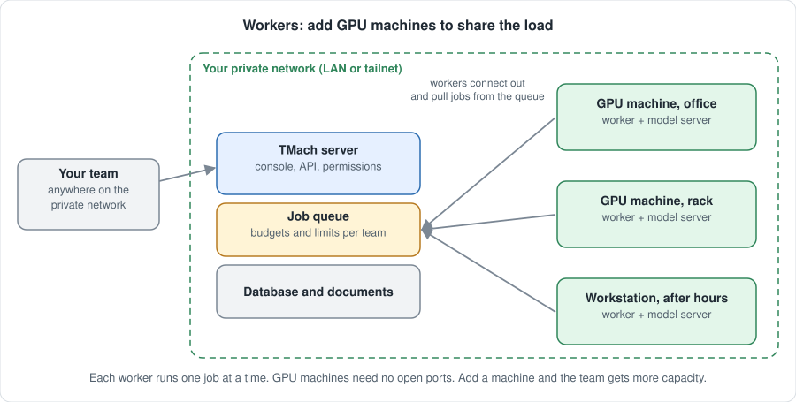

# Deploying on a tailnet

This page sets up a TMach server that is reachable only from your own private
Tailscale network (a "tailnet"). People on the tailnet open it in a browser.
GPU machines on the tailnet connect to it as workers. Nothing is exposed to the
public internet.



It is the server half of
[blueprint 2](ops/deployment-blueprints.md).
The worker half is [the GPU fleet runbook](ops/gpu-fleet-runbook.md).

## What you need

- A Linux or macOS machine for the server, joined to your tailnet
  (`tailscale status` shows it).
- [Nix](https://nixos.org/download) on that machine, or the container image
  (see [the container guide](ops/container.md)). The steps below use Nix.
- A model server the TMach server can reach, such as ollama on the same
  machine. Any OpenAI-compatible `/v1/chat/completions` endpoint works.

## 1. Decide who can reach the server

`TMACH_BIND` takes one address, so the value you pick is the whole decision.

| `TMACH_BIND` | Reachable from | Use it when |
|---|---|---|
| `127.0.0.1` (default) | the server machine only | trying it out |
| the machine's tailnet address | devices on your tailnet | **the setup on this page** |
| `0.0.0.0` | the tailnet, the local network and the machine itself | people on the office network should reach it without Tailscale |

Find the tailnet address with `tailscale ip -4`. It starts with `100.`.

There is no value that means "tailnet and local network, but nothing else".
`0.0.0.0` listens on every interface, including container bridges, so pair it
with a firewall (see [Also on the local network](#also-on-the-local-network)).

Traffic inside a tailnet is encrypted by WireGuard, so plain HTTP on the tailnet
address is private on the wire. What you do not get is the browser padlock. If
you want that, read [HTTPS with `tailscale serve`](#https-with-tailscale-serve)
before you turn it on. It has a catch.

## 2. Set the encryption key before you store a real credential

TMach has to keep some credentials in a form it can use again: the mail relay
password, S3 access keys, webhook and feed secrets, worker keys, two-factor
seeds. It encrypts them with one key, `TMACH_SECRET_KEY`.

**With no key set it stores them unencrypted and carries on working.** Nothing
fails and no screen warns you. The only places that say so are the boot log and
`GET /api/admin/status`, which read `secrets: plaintext`. A key can be added
later with no migration, but anything typed in before then sits readable in the
database file, and that file goes into every backup.

So do this before anybody enters a relay password, issues an S3 key or turns on
two-factor:

```bash
# 1. Once, on the server machine. The key goes in a file only this account can
#    read. Never in git, never on an `Environment=` line, never in a Nix
#    expression.
mkdir -p ~/.config/tmach && umask 077
printf 'TMACH_SECRET_KEY=%s\n' "$(openssl rand -hex 32)" > ~/.config/tmach/secret.env

# 2. Hand it to the server.
#    systemd:   EnvironmentFile=%h/.config/tmach/secret.env   then restart
#    by hand:   set -a; . ~/.config/tmach/secret.env; set +a

# 3. If the instance already stored credentials, encrypt what is there. Run it
#    with the key loaded as in step 2, and with the same DATABASE_URL or
#    TMACH_DATA_DIR the server uses if you changed either. Safe to re-run;
#    rows already encrypted are left alone.
telemachus-secrets rewrap

# 4. Check, rather than assume.
telemachus-secrets status      # each line: N stored, N sealed, 0 in the clear
```

`GET /api/admin/status` should now read `"secrets": "sealed"` with a
`secret_key_id`. If it still says `plaintext`, the server did not get the key.
Stop there and do not enter a credential.

Three things about the key itself:

- **Keep a copy somewhere the database backup does not go.** Stored beside the
  backup it protects nothing. If it is lost, every stored credential has to be
  typed in again.
- **Generate it once, by hand.** Never at boot: a key made fresh on each start
  encrypts everything with a key nobody has.
- **It is not `TMACH_SECRET`.** That one is the token pepper, and changing it
  signs everybody out.

Full procedures, including rotating the key, are in
[the secrets runbook](ops/secrets-at-rest-runbook.md).

## 3. Install and start the server

```bash
nix profile install github:IoTone/Telemachus      # puts telemachus-server on the machine
```

Start it by hand first, on the default loopback address, so you can read the
boot log and create the first account:

```bash
set -a; . ~/.config/tmach/secret.env; set +a
TMACH_MODEL_URL=http://127.0.0.1:11434/v1/chat/completions \
TMACH_MODEL=qwen2.5:7b \
telemachus-server
```

The boot log should say `secrets: sealed`. If it says `plaintext`, go back to
step 2.

Data goes in `~/.local/state/telemachus` unless you set `TMACH_DATA_DIR`. The
database is SQLite there by default; set `DATABASE_URL` to use PostgreSQL. Every
setting is listed in [the configuration reference](ops/configuration.md).

About the model: the console's chat streams from the endpoint in
`TMACH_MODEL_URL`, so the server needs one it can reach. Without it, chat
replies are a simulated echo and are marked as such. Pick a model that answers
directly. Reasoning models such as `qwen3.5` put the answer in a separate field
and show up as a blank reply.

## 4. Create the first account

The first account is the operator. Creating it is only allowed from the server
machine's loopback address, so that a fresh server on a network does not belong
to whoever finds it first. That is why step 3 starts on loopback: do this before
you put the server on the tailnet.

On the server machine, either open `http://127.0.0.1:8835` and use the **First
run** form on the sign-in screen, or:

```bash
read -rs -p 'operator password: ' PW; echo
curl -s -X POST http://127.0.0.1:8835/api/bootstrap \
  -d "$(jq -n --arg u "$USER" --arg p "$PW" '{username:$u,password:$p}')"
unset PW
```

The operator password must be at least 12 characters. Add everyone else later
from the console under **Team**. Member passwords must be at least 8 characters.

If you cannot get a shell or a browser on the server machine, set
`TMACH_BOOTSTRAP_SECRET` on the server and send the same value in an
`X-Telemachus-Bootstrap` header from another machine.

## 5. Put it on the tailnet

Stop the server and start it again with the tailnet address:

```bash
TMACH_BIND="$(tailscale ip -4)" \
TMACH_MODEL_URL=http://127.0.0.1:11434/v1/chat/completions \
TMACH_MODEL=qwen2.5:7b \
telemachus-server
```

The boot log now warns that it is serving plain HTTP on a non-loopback address.
That warning is expected for this setup.

### Run it as a service

Once that works, a systemd user unit keeps it running. Save this as
`~/.config/systemd/user/tmach.service`:

```ini
[Unit]
Description=TMach server

[Service]
EnvironmentFile=%h/.config/tmach/secret.env
Environment=TMACH_BIND=100.x.y.z
Environment=TMACH_MODEL_URL=http://127.0.0.1:11434/v1/chat/completions
Environment=TMACH_MODEL=qwen2.5:7b
ExecStart=%h/.nix-profile/bin/telemachus-server
Restart=on-failure
RestartSec=5
TimeoutStopSec=60

[Install]
WantedBy=default.target
```

```bash
systemctl --user daemon-reload
systemctl --user enable --now tmach
loginctl enable-linger "$USER"        # keep it running when you log out
journalctl --user -u tmach -f         # the boot log
```

Notes on the unit:

- Replace `100.x.y.z` with the output of `tailscale ip -4`. A unit file cannot
  run a command to work it out.
- `ExecStart` must be an absolute path, and `~` does not expand in a unit file.
  Check it with `command -v telemachus-server`. A wrong path shows up as a
  restart loop with status `203/EXEC`.
- The key comes from `EnvironmentFile`, not an `Environment=` line. Unit files
  are readable by other accounts and end up in backups.
- On a stop, the server gives running jobs 25 seconds to finish and then hands
  them back to the queue. `TimeoutStopSec` needs to be longer than that.
- If the server starts before Tailscale has its address, the bind fails and
  `Restart=on-failure` tries again.

## 6. Check it from another device

From a different machine on the tailnet:

```bash
curl -s http://<server tailnet address>:8835/health      # {"ok":true,...}
```

Then open `http://<server tailnet address>:8835` in a browser and sign in. If
MagicDNS is on in your tailnet, the machine's name works in place of the
address.

Test from another device, not from the server. A request the server makes to
its own address proves nothing about what the network allows.

## 7. Connect GPU workers

Each GPU machine joins the tailnet and runs a worker that connects out to the
server. Workers need no open ports. In the worker's unit file, point it at the
server's tailnet address or name:

```ini
Environment=TMACH_URL=http://<server tailnet address>:8835
```

[The GPU fleet runbook](ops/gpu-fleet-runbook.md) covers the rest: one worker
per card, the model servers, the worker tokens and the unit files in
`deploy/gpu-fleet/`.

Raise the team's `ai.concurrency` limit when you add workers. It defaults to 2,
so four workers still run two jobs at a time until you change it.

## 8. Limit who on the tailnet can reach it

By default every device on a tailnet can reach every other device. If your
tailnet has people or machines that should not use TMach, narrow it in the
tailnet policy file (Tailscale admin console, **Access controls**):

```jsonc
"acls": [
  { "action": "accept", "src": ["group:tmach-users"], "dst": ["tag:tmach-server:8835"] },
  { "action": "accept", "src": ["tag:tmach-worker"],  "dst": ["tag:tmach-server:8835"] }
]
```

Workers only need to reach the server's port. Nothing needs to reach the
workers.

## Also on the local network

A server bound to its tailnet address is invisible to a laptop on the same
office network unless that laptop is on the tailnet too. To answer on both,
bind every interface:

```bash
TMACH_BIND=0.0.0.0 telemachus-server        # plus the settings from step 5
```

Then open the port in the host firewall, scoped to the local subnet. With `ufw`:

```bash
sudo ufw allow from 192.168.1.0/24 to any port 8835 proto tcp
sudo ufw status
```

Tailscale installs its own firewall rules, which is why the tailnet path works
without this step and the local network path does not.

Two things to know before you do this:

- Local network traffic is plain HTTP and is not encrypted the way tailnet
  traffic is.
- Anyone on that network can reach the sign-in page. If `TMACH_HOME=beta` is
  set, they can also reach the public signup page, which takes submissions
  without an account.

## HTTPS with `tailscale serve`

`tailscale serve` puts a real certificate on the machine's tailnet name, so the
browser shows a padlock. The app listens on `127.0.0.1` and Tailscale forwards
to it.

**Set `TMACH_LOOPBACK_TRUST=off` when you do this.** TMach normally treats a
request from the loopback address as coming from the server machine itself. Such
a request may say who it is with the `X-Telemachus-User` and `X-Telemachus-Team`
headers instead of a token, and may create the first account. Behind
`tailscale serve`, every request reaches the app from the loopback address,
whoever sent it. With the setting off, loopback gets no special treatment:
everyone signs in or presents a token.

TMach also refuses to treat a request as local when it carries a header that
proxies add, such as `X-Forwarded-For`. That catches most proxies even if you
forget the setting. Set it anyway, so you are not relying on what a particular
proxy happens to send.

One limit remains. The sign-in rate limit counts attempts per calling address,
and behind a proxy every caller has the same one. The per-account limit still
applies.

Steps:

1. Create the operator account first (step 4), with the app on loopback and no
   proxy in front.
2. In the Tailscale admin console, under **DNS**, turn on **MagicDNS** and
   **HTTPS Certificates**.
3. On the server machine, once: `sudo tailscale set --operator=$USER`.
4. Run the app with `TMACH_BIND=127.0.0.1` and `TMACH_LOOPBACK_TRUST=off`. Set
   `TMACH_PUBLIC_URL` to the `https://<machine>.<tailnet>.ts.net` address so
   links in emails are right.
5. `tailscale serve --bg 8835`.
6. From another device, check that a request with a made-up identity is turned
   away:
   ```bash
   curl -s -o /dev/null -w '%{http_code}\n' https://<machine>.<tailnet>.ts.net/api/whoami \
     -H 'X-Telemachus-User: someone' -H 'X-Telemachus-Team: default'      # 401
   ```

`TMACH_STRICT_STARTUP=1` makes the server refuse to start with no encryption
key. It also refuses plain HTTP on a non-loopback address, so it does not work
with the direct tailnet bind. It only fits a loopback bind behind a proxy.

The app's own `TMACH_TLS=1` uses a self-signed certificate unless you give it
one, which gets you a browser warning instead of a padlock. It is not a good fit
for a tailnet.

## A public URL with `tailscale funnel`

`tailscale funnel` publishes the same forwarded port to the public internet.
Everything in the section above applies, and `TMACH_LOOPBACK_TRUST=off` is not
optional here. The audience is now everyone, so also:

- Make sure every account has a strong password, and turn on two-factor for the
  operator.
- Expect automated probing of the sign-in page. Sign-in attempts are rate
  limited per account.
- Turn Funnel off when you are done: `tailscale funnel reset`.

A private tailnet is the setup this page is for. For a permanent public address,
a reverse proxy you control with your own certificate is the better fit. The
same setting applies.

## How far this has been tested

- The direct tailnet bind, the encryption key steps, the local network bind and
  the workers have been run on the project's own demo machines.
- The systemd unit for the server on this page is a starting point. The demo
  runs under systemd, but this exact file has not been run as written.
- `TMACH_LOOPBACK_TRUST` and the forwarded-header rule are covered by the
  project's automated tests, using requests that carry the headers a proxy
  adds. They have not been tested against a live `tailscale serve` or
  `tailscale funnel`.
